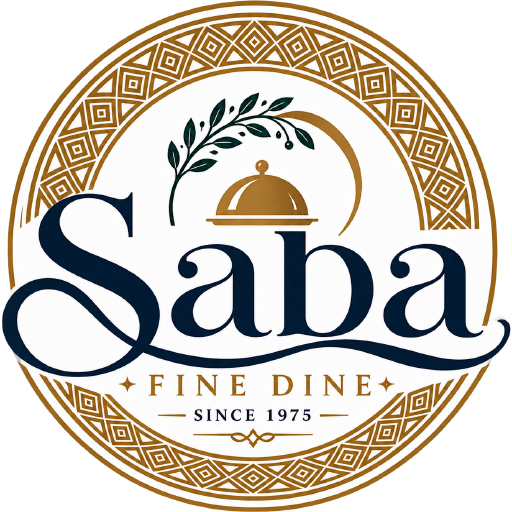

<div align="center">
  

  <h1>Saba Restaurant Suite</h1>
  <p><strong>Billing, kitchen order tickets and floor management for fine dining.</strong><br>
  Runs on the restaurant's own network. No internet, no subscription, no dependencies.</p>
</div>

---

## What it is

One small server on a computer in the back office, and a browser on every
screen in the building: the captain's tablet, the pass in the kitchen, the
till at the front, the manager's laptop. They all read and write the same
tables at the same time. Unplug the internet and nothing changes.

It is written in plain JavaScript against Node's own standard library. There
are **no runtime dependencies at all** — nothing to `npm install`, nothing to
compile on the till, nothing that goes stale between now and the restaurant's
third year of using it.

## What it does

| | |
|---|---|
| **Floor** | Live plan of every room. Seat, move, merge and transfer tables; covers, elapsed time and running total on each; reservations seated straight onto the plan. |
| **Order** | The carte by course, with modifiers, allergy notes and seat numbers. Fire a course and the kitchen sees it before the captain has put the tablet down. |
| **Kitchen** | A ticket per course per station, timed, with the ones that are running late brought to the front. Bump, recall, reprint. |
| **Bills** | Print, split (by seat, by item, or evenly), part-pay across cash, card and UPI, discount with manager approval, void and comp with a reason that is kept. |
| **Tax** | Service charge and CGST/SGST worked out per line, in whole paise, with the rates and the round-off set in one place. |
| **Reports** | Today's trading as it happens; the Z report and cash-up at close; thirty days of history; sales by item, by hour, by server and by payment method; a GST summary; CSV export of all of it. |
| **Book** | Reservations with covers, time, table and a note, carried through to the floor plan. |
| **Menu** | Add a dish, price it, move it between sections, courses and stations, retire it, and 86 it from anywhere in the building. |
| **Setup** | The bill header, staff and their PINs, the service charge and tax rates, the rooms and tables, backups, and the live list of terminals. |
| **Cloud** | Optional. An off-site copy in Supabase: bills and the audit trail push up, the menu and staff sync both ways, and the takings are readable from anywhere. Off by default, and the restaurant trades the same without it. |

Every screen is one of four roles' business — manager, captain, cashier,
kitchen — and the server enforces that, not the interface.

## Try it without installing anything

There is a demonstration on the web: the whole application, running against a
till that lives in your browser tab.

> **[Open the demonstration →](https://vormirtech-ai.github.io/TBC-BILLING/saba/)**
> Sign in as Manager with PIN 1379.

It is built from this directory by `tools/build-site.mjs` and published by
GitHub Pages. Every screen, every figure and every refusal is the product's
own code — `tests/till/parity.test.mjs` runs a service through both the real
server and the browser till and fails if a single paisa differs.

What it is **not** is a place to run a restaurant. A till is a server with a
database on the restaurant's own computer; a web page cannot be one, and the
restaurant's bills should not be on the public internet in the first place.
The demonstration keeps everything in the tab and forgets it when the tab
closes.

## Getting it running for real

**On a restaurant's till** (Linux, systemd, Node 22.5+) — the normal way:

```sh
sudo ./install.sh
```

**To look at it on a laptop**, with a month of trading and a room mid-service
already in it:

```sh
npm run demo        # then open http://localhost:8080, PIN 1379
```

**Anywhere else**, including in Docker if you prefer it:

```sh
node server/main.js        # or: docker compose up -d
```

Each prints the address to open on the tablets, and the manager PIN, once.
None of them needs Docker, and none of them needs the website.

Full instructions, including the network and the printers:
**[docs/DEPLOYMENT.md](docs/DEPLOYMENT.md)**.

## Running it day to day

Opening and closing, the Z report, backups, restoring one, adding staff,
changing prices, and what to do when something goes wrong:
**[docs/OPERATIONS.md](docs/OPERATIONS.md)**.

## Taking it over

The shape of the code, where each decision lives, how to change the tax
rules, add a screen or add a role, and the things a future maintainer would
otherwise have to find out the hard way:
**[docs/HANDOVER.md](docs/HANDOVER.md)**.

## Tests

```sh
npm test
```

Ninety-five cases: the pricing and order maths as pure functions, the API
against a real server on a real SQLite database over real HTTP, the published
demonstration held against the product it demonstrates, and the cloud sync
against a stand-in for Supabase. Nothing is mocked. A point of sale is a thing that takes money; a suite that stubs out
the database proves only that the stubs work.

```sh
npm test unit     # the domain, instantly
npm test api      # a real server per case
npm test till     # the demonstration, against the real thing
npm test sync     # the cloud copy
```

The Supabase SQL is verified separately, against an actual PostgreSQL, since
the test suite must not need one:

```sh
npm run verify-cloud "postgresql://user@host/db"
```

## An off-site copy, if the restaurant wants one

Saba needs no cloud and asks for none. Point it at a Supabase project and it
will also keep a copy there: bills, dockets and the audit trail push up,
while the menu, the charges and the staff list sync both ways, so a price can
be changed from a phone.

Bills only ever travel upward — the till owns what happened, and nothing in
the cloud can alter what a guest was charged. PINs never leave the building
at all.

**[docs/CLOUD-SYNC.md](docs/CLOUD-SYNC.md)** — creating the project, the SQL to
run, where each key goes, and how to read the takings in Supabase.

## Requirements

- Node 22.5 or newer (22.22 LTS is what the Docker image pins).
- A computer that stays switched on. A mini PC or a Raspberry Pi 5 is plenty.
- A wifi network the tablets can reach it on. It does not need internet.

## Licence

Commercial. One licence per restaurant. See [LICENSE.txt](LICENSE.txt).
